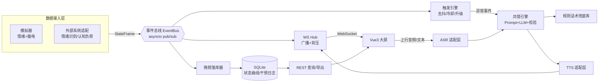

# 智能疏导仓共情语音交互与状态监测系统 —— 实现方案

> 对应任务书：题目二《基于大模型的智能疏导仓共情语音交互与状态监测系统》
> 目标：从零搭建一套**端到端可运行**的 B/S 系统 Demo，覆盖任务书四个模块 + 工程要求（高实时、抗幻觉、结构规范）。

---

## 一、方案总览

### 1.1 架构分层（事件驱动 + 适配器模式）



**为什么这样分层**：任务书要求「接入**现有**情绪识别系统与认知负荷系统」，说明数据源会换；要求「接入**开源大模型 API**」，说明模型会换。因此把**变化点全部收敛为适配层接口**（`StateSource` / `LlmProvider` / `AsrProvider` / `TtsProvider`），业务编排只依赖接口。这样当前无 API Key 也能全链路跑通，拿到 Key 只改 `.env` 一个字段。

### 1.2 技术选型（已确认）

| 层 | 选型 | 说明 |
|---|---|---|
| 后端 | Python 3.12 + FastAPI + uvicorn | 原生 async WebSocket，AI/语音 SDK 生态最全 |
| 数据校验 | Pydantic v2 | 数据契约单一真源，WS/REST 共用 |
| 数据库 | SQLite + SQLAlchemy 2.0 async + aiosqlite | 零部署，异步不阻塞事件循环 |
| 前端 | Vue 3 + Vite 5 + TypeScript + ECharts 5 | Node 18 兼容；ECharts 适合实时曲线大屏 |
| 实时通道 | 原生 WebSocket（JSON 文本帧 + 二进制音频帧） | 不引入 Socket.IO，减少黑盒、贴合课程考点 |
| 测试 | pytest + pytest-asyncio + httpx | 覆盖触发去抖、话术校验、REST 查询 |

**依赖安装**：`fastapi`、`uvicorn[standard]`、`aiosqlite`、`pydantic-settings`、`pytest`、`pytest-asyncio`（`pydantic/sqlalchemy/websockets/httpx` 已就位）。

### 1.3 目录结构

```
计网工程大作业/
├─ backend/
│  ├─ app/
│  │  ├─ main.py                 # FastAPI 入口 + lifespan 组装
│  │  ├─ config.py               # pydantic-settings 读 .env
│  │  ├─ schemas.py              # 【数据契约】StateFrame / Intervention / WS 消息
│  │  ├─ bus.py                  # EventBus：asyncio.Queue 多订阅者扇出
│  │  ├─ hub.py                  # WS Hub：连接注册 + 每连接队列背压广播
│  │  ├─ api/
│  │  │  ├─ ws_monitor.py        # /ws/monitor  下行状态流
│  │  │  ├─ ws_voice.py          # /ws/voice    全双工语音/文本
│  │  │  ├─ logs.py              # 历史查询 + CSV/JSON 导出
│  │  │  └─ system.py            # /api/health、/api/scenario 场景注入
│  │  ├─ sources/
│  │  │  ├─ base.py              # StateSource 抽象 + 采样率
│  │  │  ├─ simulator.py         # 内置情绪/脑电模拟器（含剧本）
│  │  │  └─ external.py          # 对接真实系统的 WS/HTTP 适配（预留）
│  │  ├─ decision/
│  │  │  ├─ trigger.py           # 异常判定状态机（窗口/连续/冷却/升级）
│  │  │  ├─ prompt.py            # 结构化 Prompt 模板 + few-shot
│  │  │  ├─ validator.py         # 抗幻觉输出校验（JSON Schema+禁词+长度）
│  │  │  └─ empathizer.py        # 共情引擎编排：LLM→校验→兜底
│  │  ├─ providers/
│  │  │  ├─ llm/{base,mock,zhipu}.py
│  │  │  ├─ asr/{base,mock}.py
│  │  │  └─ tts/{base,mock,edge}.py
│  │  ├─ db/{models,session,repo}.py
│  │  └─ service/pipeline.py     # 顶层编排：状态→触发→生成→TTS→广播→落库
│  ├─ tests/{test_trigger,test_validator,test_api,test_ws}.py
│  ├─ requirements.txt
│  └─ .env.example
├─ frontend/
│  ├─ src/
│  │  ├─ views/{DashboardView,HistoryView}.vue
│  │  ├─ components/{EmotionGauge,CognitiveLoadChart,StateTimeline,InterventionFeed,VoicePanel,ScenarioPanel}.vue
│  │  ├─ composables/{useMonitorSocket,useVoiceSocket}.ts   # 断线重连+心跳
│  │  ├─ api/http.ts
│  │  ├─ types/contract.ts       # 与 schemas.py 一一对应
│  │  └─ router/index.ts
│  ├─ vite.config.ts             # /api /ws 代理到 :8000
│  └─ package.json
└─ docs/系统设计与工程实现报告.md   # 任务书验收要求的报告（随代码同步更新）
```

---

## 二、核心设计决策（方案"优雅"的落点）

### D1 数据契约单一真源

`schemas.py` 定义唯一的 `StateFrame`，WS 下行、REST 查询、数据库落库、前端 TS 类型四处对齐，避免字段漂移。

```python
class Emotion(BaseModel):
    label: Literal["Positive", "Negative", "Neutral"]
    confidence: float = Field(ge=0, le=1)

class Cognitive(BaseModel):
    level: Literal["Low", "Medium", "High"]
    score: float = Field(ge=0, le=100)   # 认知负荷 0-100

class StateFrame(BaseModel):
    ts: float                 # 服务端统一时间戳（秒）
    session_id: str
    emotion: Emotion
    cognitive: Cognitive
    source: str = "simulator"
```

WS 消息统一信封，便于前端按 `type` 分发：

```python
class Envelope(BaseModel):
    type: Literal["state", "intervention", "speak", "asr_partial", "asr_final", "error", "meta"]
    payload: dict
```
> `intervention` 承载话术卡片；`speak` 承载 TTS 音频（base64）或降级播报文本。

### D2 事件总线解耦（`bus.py`）

数据源只负责 `bus.publish(frame)`；广播、决策、落库三个订阅者各自独立消费。**新增一个消费者不需要改数据源**（如后期加"Webhook 告警"只需再订阅一次）。

```python
class EventBus:
    def __init__(self) -> None:
        self._subs: set[asyncio.Queue] = set()

    def subscribe(self, maxsize: int = 64) -> asyncio.Queue:
        q: asyncio.Queue = asyncio.Queue(maxsize=maxsize)
        self._subs.add(q)
        return q

    def publish(self, item) -> None:
        for q in self._subs:
            if q.full():          # 背压：丢最旧帧，绝不阻塞生产者
                q.get_nowait()
            q.put_nowait(item)
```

### D3 背压与"不卡顿"（`hub.py`）

任务书硬性要求「WebSocket 数据流推送不卡顿」。工程手段三件套：

1. **每连接独立队列 + 独立发送协程**：慢客户端只拖慢自己，不阻塞广播循环（严禁 `await ws.send_json()` 写在广播 for 循环里）。
2. **drop-oldest 背压**：队列满即丢弃最旧帧，保证实时性优先于完整性。
3. **前端渲染节流**：状态流以 10Hz 采集，前端以 `requestAnimationFrame`/100ms 批量 `setOption`，ECharts 只保留滑动窗口（如最近 300 点）。

```python
class WSClient:
    def __init__(self, ws, queue_size: int):
        self.ws, self.q = ws, asyncio.Queue(maxsize=queue_size)
    async def sender(self):
        while True:
            env = await self.q.get()
            await self.ws.send_json(env.model_dump())
```

### D4 触发引擎：先"去抖"，再调 LLM（**抗幻觉的第一道防线**）

不逐帧调 LLM（会导致 token 爆炸、重复话术、幻觉堆叠）。判定为**状态机**：

- **滑窗**：最近 `WINDOW=15` 帧（约 1.5s）
- **异常条件**：`emotion.label == Negative 占比 ≥ 0.6` **或** `cognitive.level == High 占比 ≥ 0.6`
- **去抖**：需**连续**满足 ≥ `MIN_CONSEC=10` 帧才确认进入异常态
- **冷却**：触发后 `COOLDOWN=60s` 内不再重复触发同类
- **升级**：异常等级（`normal < mild < severe`）升高时**立刻**打断冷却，允许再次干预
- **恢复**：恢复常态后重置状态机，记录 `recovered_at`

所有阈值放 `.env`，便于答辩时演示"调参"。产出 `TriggerEvent(kind, severity, reason, window_stats)`。

### D5 Prompt 工程 + 双层抗幻觉

**Prompt 结构**（`prompt.py`）——角色 / 约束 / 输入 / 输出模式 / few-shot 五段式：

```
[角色] 你是疏导仓内的心理安抚助手，只做情绪陪伴与放松引导，不做医学诊断。
[约束] 1) 禁止诊断性结论（如"你有抑郁症"）；2) 禁止建议用药；
       3) 话术 ≤ 60 字，口语化、可朗读；4) 只输出 JSON，不要多余文字。
[输入] {"emotion": "Negative(0.86)", "cognitive": "High(82)", "trend": "负向持续 12s"}
[输出] {"speech":"...","strategy":"呼吸引导|共情复述|环境调节|轻量提问","risk":"low|medium|high"}
[示例] ...
```

**第二道防线**（`validator.py`）——对 LLM 原始输出做硬校验：

| 校验项 | 规则 | 失败处理 |
|---|---|---|
| JSON 可解析 | 容错剥离 ```json 围栏 / 截取首尾花括号 | 重试 1 次 → 兜底 |
| 字段完备 | `speech/strategy/risk` 齐全且枚举合法 | 兜底 |
| 长度 | `1 ≤ len(speech) ≤ 80` | 截断或兜底 |
| 禁词表 | 「诊断/抑郁症/药/自杀（除高危转介模板）」等命中即拒 | 兜底 |
| 安全出口 | 高危信号 → 强制输出专业求助渠道话术 | 覆盖 |

校验失败 → 落到**规则话术库**（`FALLBACK`，按 `strategy × severity` 索引的确定性话术），并在响应中标注 `degraded=true`。前端可显示"降级"角标，答辩时可作为"抗幻觉设计"的直观证据。

### D6 外部云服务适配层：Mock 优先，一处切换

```python
class LlmProvider(Protocol):
    name: str
    async def complete(self, messages: list[dict], **kw) -> str: ...

class TtsProvider(Protocol):
    name: str
    async def synth(self, text: str, voice: str) -> TtsResult: ...  # audio_b64 | speak_text
```

- `LLM_PROVIDER=mock`：返回**上下文相关**的模板话术（读取真实状态 → 选槽位），保证演示语义合理，且**离线可用、零成本、零延迟抖动**。
- `LLM_PROVIDER=zhipu`：`httpx` 调 GLM `chat/completions`，`ZHIPU_API_KEY` 从 `.env` 读。
- TTS 降级设计：Mock TTS **不合成音频**，返回 `speak_text`，前端用浏览器原生 `speechSynthesis` 播报 → 无 Key 时依然"有声音"；接真实 TTS 后返回 base64 MP3，前端 `<audio>` 播放。**同一份前端逻辑，两种后端能力。**
- ASR 降级：Mock ASR 直接回显文本（配合前端可选的 Web Speech 识别），真实 ASR 走云服务 WebSocket 流式接口。

`/api/health` 返回各 provider 的 `name / mode(mock|real) / ready`，前端顶部常驻显示，避免"以为在调真模型其实在 Mock"的尴尬。

### D7 持久化：降频落库 + 双表设计

- **`state_frames` 按 1Hz 落库**（采样 10Hz → 聚合降频），避免长时间运行导致 SQLite 膨胀；保留 `emotion_label/confidence/cognitive_level/cognitive_score/session_id/ts`。
- **`interventions`**：`session_id, triggered_at, kind, severity, reason(JSON), prompt_digest, speech, strategy, risk, degraded, provider, audio_available`。这张表就是任务书的「干预记录」。
- 索引：`(session_id, ts)` 复合索引支撑时间范围查询。
- 导出：`GET /api/export/states.csv`、`/api/export/interventions.csv`，用 `StreamingResponse` 流式输出，前端直接 `<a download>`。

### D8 语音闭环（全双工）

```
前端录音(MediaRecorder) → WS 二进制帧 → ASR → Empathizer(注入当前实时状态上下文)
                                                          ↓
   前端播放  ←── speak( audio_b64 | speak_text ) ←── TTS
```
要点：语音对话时**把最新 `StateFrame` 注入 Prompt**（"用户当前 Negative/High"），实现任务书所说"语音输入状态结合 LLM 生成语音播报"；WS 文本/二进制帧混用，二进制帧前置 1 字节类型标记（`0x01`=音频块，`0x02`=控制）。

### D9 演示友好：场景注入

`POST /api/scenario` 可注入剧本：`calm` / `anxiety_escalation` / `recovery` / `high_load`。
模拟器按剧本演化（含平滑随机游走 + 突变），**答辩时可一键播放"平静→焦虑升级→触发共情→语音播报→恢复"的完整闭环**，不依赖真实硬件。这是 Demo 录屏的关键开关。

---

## 三、实施步骤

### Phase 0 脚手架与配置
- 建 `backend/app` 目录树、`requirements.txt`、`.env.example`（阈值、provider 开关、端口）。
- `config.py` 用 `pydantic-settings` 统一读配置，`.env` 不入库（提供 `.env.example`）。
- `pip install fastapi aiosqlite "uvicorn[standard]" pytest pytest-asyncio`。
- 前端：`npm create vite` (vue-ts) → `npm i echarts vue-router` → `vite.config.ts` 配 `/api`、`/ws` 代理。

### Phase 1 数据契约 + 总线 + 数据源 + WS Hub
- 写 `schemas.py`（`StateFrame`/`Envelope`/`Intervention`）与前端 `types/contract.ts` 对齐。
- `bus.py` 事件总线；`hub.py` 连接管理器（含背压）。
- `sources/simulator.py`：10Hz 生成、剧本支持、平滑随机游走；`sources/base.py` 抽象 + `external.py` 预留。
- `api/ws_monitor.py`：`/ws/monitor` 下发 `state` 帧 + 心跳 ping。
- **验收**：`wscat`/浏览器控制台能看到持续 JSON 帧，且 `postman`/前端断开重连后自动恢复。

### Phase 2 触发引擎 + Prompt + LLM 适配 + 抗幻觉
- `decision/trigger.py` 状态机（窗口/连续/冷却/升级/恢复）。
- `decision/prompt.py` 五段式模板 + few-shot + 状态注入。
- `providers/llm/{base,mock,zhipu}.py`；`decision/validator.py` 硬校验 + 禁词 + 兜底话术库。
- `decision/empathizer.py` 串联：触发事件 → Prompt → Provider → Validator → `Intervention`。
- **验收**：`pytest tests/test_trigger.py tests/test_validator.py` 全绿；手动注入 `anxiety_escalation` 能产出合法 JSON 话术，构造非法输出能正确降级。

### Phase 3 持久化 + REST 查询/导出
- `db/models.py` 双表 + 复合索引；`db/session.py` async engine；`db/repo.py` 查询/写入。
- `service/pipeline.py` 编排：订阅 bus → 降频落库 + 触发 → 生成 → 落库 → 广播 `intervention`。
- `api/logs.py`：`/api/sessions`、`/api/states`、`/api/interventions`、`/api/export/*.csv`。
- `api/system.py`：`/api/health`、`POST /api/scenario`。
- **验收**：`pytest tests/test_api.py` 全绿；curl 能拿到 CSV。

### Phase 4 前端监测大屏 + 历史页
- `composables/useMonitorSocket.ts`：指数退避重连 + 心跳超时检测 + 按 `type` 分发。
- `EmotionGauge`（情绪占比环形）、`CognitiveLoadChart`（ECharts 实时折线，滑窗 300 点，100ms 节流）、`StateTimeline`（色带时间轴）、`InterventionFeed`（话术卡片流，含 strategy/risk/降级角标）、`ScenarioPanel`（一键剧本）。
- `HistoryView.vue`：时间范围 + 会话筛选，表格分页，CSV 导出按钮。
- **验收**：`npm run dev` 后大屏曲线实时流动，无明显掉帧；注入剧本能实时弹出干预卡片。

### Phase 5 语音闭环
- `providers/asr/*`、`providers/tts/*`（含 `edge` 真实 TTS 可选实现）。
- `api/ws_voice.py`：文本/二进制混帧协议；`VoicePanel.vue`：录音按钮、实时 ASR 字幕、播报控制（`speechSynthesis` 降级 / `<audio>` 真实音频）。
- **验收**：点录音说一句话 → 出现 ASR 文本 → 返回共情话术 → 有语音播出；同时最新状态被注入 Prompt（日志可验证）。

### Phase 6 测试、Demo 脚本与报告
- 补齐 `test_ws.py`；跑通 `pytest -q`。
- 写 `README.md` 启动说明（后端/前端两条命令 + 演示步骤）。
- 同步撰写 `docs/系统设计与工程实现报告.md`：架构图、时序图、数据契约、Prompt 工程与抗幻觉论证、压力/延迟测试记录（用脚本统计推送帧率与端到端延迟）、测试用例矩阵（不同异常组合 → 安抚策略合理性）。
- **验收**：新机器按 README 两条命令即可跑通全链路。

---

## 四、假设与决策

| # | 决策 | 理由 / 影响 |
|---|---|---|
| A1 | 当前**无外部 API Key**，默认全 Mock | 保证离线可演示；适配层已留真实实现，改 `.env` 即切换 |
| A2 | 「现有情绪识别/认知负荷系统」暂以**内置模拟器**替代 | 工作区为空，无对接目标；`StateSource` 接口已抽象，后续填 `external.py` |
| A3 | 不引入 Socket.IO / Redis | 单机 Demo 无需额外中间件，减少黑盒，突出 WebSocket 课程考点 |
| A4 | SQLite 而非 MySQL | 零部署、够用；SQLAlchemy 抽象已在，换库改连接串 |
| A5 | 状态帧 10Hz 采集、1Hz 落库、前端 100ms 节流 | 实时感与资源占用的平衡点 |
| A6 | 中文话术 | 任务书为中文场景；Prompt 与兜底库均中文 |
| A7 | `docs/...报告.md` 为任务书明确交付物 | 属验收要求，随实现同步产出 |
| A8 | 前端用 TypeScript | 契约字段多，类型对齐能显著降低联调成本 |

**风险与规避**：LLM 延迟高（任务书要求优化"占位交互"）→ 前端收到 `intervention.pending` 先显示"正在组织语言…"骨架态，拿到结果再替换，语音则先播一句占位提示音；真实云服务不稳定 → 统一超时 + 重试 1 次 + 兜底话术。

---

## 五、验证方式（整体）

1. **启动**：`uvicorn app.main:app --reload --port 8000`（backend）；`npm run dev`（frontend，默认 5173，已代理 `/api` `/ws`）。
2. **实时性**：大屏曲线持续滚动；`/api/health` 显示推送帧率；注入剧本时干预卡片出现延迟 < 1s（Mock 模式）。
3. **抗幻觉**：`pytest tests/test_validator.py` 覆盖 JSON 容错、禁词、超长、高危转介四类用例。
4. **决策正确性**：`pytest tests/test_trigger.py` 覆盖去抖、冷却、升级打断、恢复重置。
5. **日志与导出**：跑一轮剧本后，历史页可按时间范围查出状态曲线与干预记录，并成功下载两个 CSV。
6. **语音闭环**：录音 → 字幕 → 话术 → 播报 全链路通；断网（禁用 ASR）时降级为文本输入不报错。
7. **规范**：`pytest -q` 全绿；目录分层清晰，适配层可插拔。
