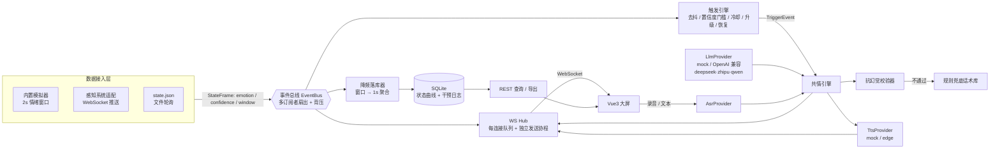
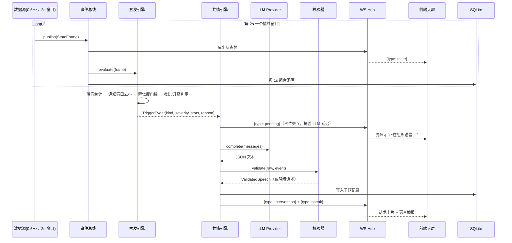

# 基于大模型的智能疏导仓共情语音交互与状态监测系统
## 系统设计与工程实现报告

| 项目 | 内容 |
|---|---|
| 题目 | 题目二 · 基于大模型的智能疏导仓共情语音交互与状态监测系统 |
| 工程方向 | 智能人机交互系统、网络全栈应用开发 |
| 技术栈 | FastAPI + 原生 WebSocket + Vue 3 + ECharts + SQLite（SQLAlchemy 2.0 async） |
| 交付形态 | B/S 架构，端到端可运行 Demo + 自动化测试 + 本报告 |

---

## 一、需求映射

任务书提出四项核心任务与若干工程要求，与实现模块的对应关系如下：

| # | 任务书要求 | 实现位置 | 关键设计 |
|---|---|---|---|
| 1 | 状态数据接入与可视化：后端 WebSocket 同步接收现有情绪识别系统按 2 秒滑动窗口给出的三分类结果（`emotion` / `confidence` / `window`），前端实时监测大屏 | `app/sources/*`、`app/hub.py`、`app/api/ws_monitor.py`、`frontend/src/views/DashboardView.vue` | 窗口级事件驱动；事件总线解耦；每连接队列 + drop-oldest 背压；ECharts 100ms 节流渲染 |
| 2 | 共情策略与 Prompt 工程：接入开源大模型 API，将"情绪窗口异常"转化为共情安抚话术 | `app/decision/{trigger,prompt,validator,empathizer}.py`、`app/providers/llm/*` | 去抖状态机控制调用时机；结构化五段式 Prompt；双层抗幻觉 |
| 3 | 语音交互管线：整合 ASR/TTS，形成"数字语音助手"双向闭环 | `app/providers/{asr,tts}/*`、`app/api/ws_voice.py`、`frontend/src/components/VoicePanel.vue` | 文本/二进制混帧协议；TTS 双能力形态（真实音频 / 浏览器合成） |
| 4 | 日志管理与干预记录：记录状态变化曲线与交互干预日志，支持历史查询与导出 | `app/db/*`、`app/api/logs.py`、`frontend/src/views/HistoryView.vue` | 窗口 0.5Hz 采样、按 1s 聚合落库的降频；双表 + 复合索引；流式 CSV 导出 |
| 工程要求 | 高实时不卡顿 / 抗幻觉 / 结构规范 / 完整 Demo 与报告 | 全项目 | 见第五、六、八章 |

此外，项目按申报书《基于脑电信号的认知负荷监测系统》扩展了**第二路数据源**：独立 EEG 服务按
4s 窗、1s 步输出四级脑电认知负荷（Low / Medium / High / VeryHigh），后端把它按"状态量"合并进
情绪时间线，前端新增负荷面板与负荷色带，并新增一条独立的 `high_load` 降速引导规则。
实现见 `backend/app/sources/load_source.py`、`load_parser.py`、`load_store.py`、`eeg_service/`。

---

## 二、系统架构

### 2.1 分层架构



### 2.2 分层职责与依赖方向

| 层 | 模块 | 职责 | 依赖 |
|---|---|---|---|
| 接入层 | `sources/` | 产出统一 `StateFrame`，屏蔽数据来源差异 | 仅依赖 `bus` 与 `schemas` |
| 传输层 | `bus.py` / `hub.py` | 事件扇出、连接管理、背压推送 | 不依赖任何业务 |
| 决策层 | `decision/` | 异常判定、Prompt 构造、输出校验、话术生成 | 依赖 `providers` 抽象 |
| 适配层 | `providers/` | 屏蔽大模型 / ASR / TTS 厂商差异 | 无内部业务依赖 |
| 存储层 | `db/` | 状态曲线与干预日志的持久化与查询 | 依赖 `schemas` |
| 编排层 | `service/pipeline.py` | 串联完整业务流程 | 依赖以上全部抽象 |
| 接口层 | `api/` | WebSocket 与 REST 端点 | 只读 `app.state` |
| 组装层 | `main.py` | 唯一知道所有具体实现的地方，负责依赖注入 | 依赖全部 |

**依赖方向单向向下**：接入层不认识决策层，决策层不认识数据库。因此"把模拟器换成真实情绪识别系统"
或"把 Mock 换成 DeepSeek / 智谱 GLM / 通义千问"都不需要触碰业务编排代码——这是本系统可扩展性的来源。

### 2.3 一次完整干预的时序



---

## 三、数据契约（单一真源）

全部契约定义在 `backend/app/schemas.py`，被 WebSocket 下行、REST 响应、数据库落库与
前端 `types/contract.ts` 共用，杜绝字段漂移。

系统接入两路外部数据，但对外只有一个契约：

1. **情绪通道**（感知系统，2s 一窗）：`emotion` / `confidence` / `window`，
   情绪固定为 Neutral / Positive / Negative；
2. **脑电负荷通道**（独立 EEG 服务，4s 窗 1s 步）：`level` / `confidence` / `window`，
   等级固定为 Low / Medium / High / VeryHigh（低 / 中 / 高 / 极高），与申报书表 4.1 一致。

```python
class Emotion(BaseModel):
    label: Literal["Positive", "Negative", "Neutral"]
    confidence: float         # 0~1

class CognitiveLoad(BaseModel):
    level: Literal["Low", "Medium", "High", "VeryHigh"]
    confidence: float         # 0~1
    window: str               # EEG 侧窗口，如 "12.0s - 16.0s"（可与情绪窗口不同）
    source: str               # simulator / external / file

class StateFrame(BaseModel):
    ts: float                 # 服务端统一时间戳（秒）
    session_id: str
    emotion: Emotion
    load: CognitiveLoad | None  # 该时刻最新的负荷快照；未接入时为 None
    window: str               # 感知窗口区间，如 "55.0s - 57.0s"
    source: str               # simulator / external / file
```

两路节奏不同（情绪 0.5Hz、负荷 1Hz），但业务上必须合成同一条时间线，因此负荷按
**状态量**处理：`LoadStore` 只保留最新一条，情绪帧落库/下行时贴上快照，同时通过独立的
`load` 信封即时推给前端。这样既不会因为两路对齐而丢帧，也不需要在数据库里做时间对齐。

情绪报文与感知系统写出的 `state.json` 完全一致，`latency_ms`、`camera_ok`、`frame_count`、
`logs` 等算法侧诊断字段在解析时被忽略；`confidence` 与 `window` 缺失或非法时分别回落为
`0.7` 与空串，保证外部格式漂移不会拖垮实时链路。`window` 会被规范化为
`"起点s - 终点s"`（`"55-57"`、`{"start":55,"end":57}` 同样识别），并原样写入状态曲线与 CSV。

负荷报文同样做归一（`sources/load_parser.py`）：中文等级、`L/M/H/VH`、`1~4` 编号、
百分数置信度、`score`、旧版 3 级写法以及三种外层包装都能识别；等级无法识别时整帧丢弃。

触发判定的依据同样落进契约，便于事后复核：

```python
class WindowStats(BaseModel):
    window: str               # 触发时最新的感知窗口
    window_size: int          # 参与统计的窗口数
    negative_ratio: float
    positive_ratio: float
    neutral_ratio: float
    avg_confidence: float
    negative_confidence: float  # 窗口内 Negative 片段的平均置信度
    consec_abnormal: int
    duration_s: float
    load_level: str             # 最新负荷等级（未接入时为空串）
    load_confidence: float
    load_high_ratio: float      # 窗口内"高及以上"的占比
```

WebSocket 统一信封 `{type, payload}`，前端按 `type` 分发：

| type | 方向 | 含义 |
|---|---|---|
| `meta` | 下行 | 连接元信息（会话号、当前模拟、各适配层状态）；亦用作心跳 pong |
| `state` | 下行 | 状态帧（每 2s 一个感知窗口，0.5Hz，带负荷快照） |
| `load` | 下行 | 脑电负荷更新（1Hz，独立于情绪窗口，供大屏即时刷新负荷面板） |
| `pending` | 下行 | 干预生成中，占位交互（任务书要求优化 LLM 慢响应体验） |
| `intervention` | 下行 | 干预话术卡片，含决策依据与审计字段 |
| `speak` | 下行 | 播报指令：`audio_b64`（真实 TTS）或纯 `text`（浏览器合成） |
| `asr_final` | 下行（voice 通道） | 语音识别结果 |
| `error` | 下行 | 可读错误提示 |

`Intervention` 中的审计字段（`reason` / `stats` / `prompt_digest` / `degraded` / `provider` /
`latency_ms`）使每一次干预都可事后复核，这是"避免无意义幻觉回复"这一要求在工程上的举证手段。

---

## 四、关键设计决策

### D1 事件总线解耦
数据源只调用 `bus.publish(frame)`，广播、决策、落库各自 `subscribe` 独立消费。
新增消费者（例如后续接入 Webhook 告警）无需改动数据源。

### D2 背压：实时性优先于完整性
`EventBus` 与每条 WS 连接各持一个 `asyncio.Queue(maxsize=64)`，队列满时**丢弃最旧元素**而非阻塞生产者：

```python
def publish(self, item):
    for q in self._subs:
        if q.full():
            q.get_nowait()      # drop-oldest
        q.put_nowait(item)      # 绝不 await
```

广播只做入队（非阻塞），真正的网络 IO 由每连接的独立发送协程完成。
因此**一个慢客户端只会拖慢它自己**——该性质在第八章由实测数据验证。

### D3 渲染节流
感知窗口每 2 秒到达一个，但前端仍以 100ms 节流批量 `setOption`（列布局变化、控制消息到达时
都会触发重绘），ECharts 仅保留最近 300 个窗口（约 10 分钟）。低到达率下这不会成为瓶颈，
但保留了"状态流与控制流混跑时界面不抖动"的余量。

### D4 触发引擎：先判定，再调模型
逐窗调用大模型会带来三重问题：token 浪费、话术重复、把偶发的一个负向窗口当作真异常从而产生
幻觉式结论。因此异常判定被抽成独立状态机，时间语义全部以"2 秒窗口"为单位：

| 环节 | 参数（可在 `.env` 调整） | 作用 |
|---|---|---|
| 滑动窗口 | `TRIGGER_WINDOW=4`（≈8s） | 统计窗口内 Negative 占比 |
| 越线条件 | `TRIGGER_RATIO=0.5` | Negative 片段达到一半即视为候选异常 |
| 置信度门槛 | `TRIGGER_MIN_CONFIDENCE=0.55` | Negative 片段平均置信度不足则不予采信（只延迟、不误触发） |
| 去抖 | `TRIGGER_MIN_CONSEC=2` | 连续 2 个窗口（≈4s）达标才确认，滤除偶发尖峰 |
| 冷却 | `TRIGGER_COOLDOWN_S=60` | 同类干预 60s 内不重复打扰 |
| 升级 | `TRIGGER_ESCALATE_AFTER_S=6` | 异常持续恶化时立刻打断冷却、再次干预 |
| 恢复 | `TRIGGER_RECOVERY_FRAMES=2` | 连续 2 个窗口低于阈值后确认恢复，重置状态机 |

严重度由**强度 × 持续时长 × 置信度**共同决定（而非只看窗口占比）：刚越线 → `mild`（主动陪伴），
持续 6 秒以上、负向占比 ≥0.85 且负向置信度 ≥0.70 → `severe`（专业转介）。这与心理疏导
"先陪伴、后转介"的逻辑一致，也避免了一次异常就立即抛出热线号码的体验断裂。

### D5 Prompt 工程
采用五段式结构：**角色 / 硬性约束 / 输入状态 / 输出格式 / few-shot 示例**。

约束项直接对应任务书"避免无意义幻觉回复"的要求：不做医学诊断、不提及药物、
不作疗效承诺、不把临床名词用于描述用户、话术 ≤60 字且可直接朗读；输出被强制为 JSON
（`{"speech", "strategy", "risk"}`），以便机器校验。

用户消息中保留一行机器可读摘要，被模型、Mock Provider 与审计日志共用：

```
[STATE] {"kind": "negative_emotion", "severity": "mild", "emotion": "Negative",
         "confidence": 0.82, "negative_ratio": 0.75, "window": "55.0s - 57.0s",
         "duration_s": 2.0}
```

### D6 抗幻觉：双层防线 + 安全出口

**第一层（时机）**：D4 的去抖状态机确保只在稳定异常时调用模型，从源头减少幻觉输入。

**第二层（内容）**：`validator.py` 对模型输出逐项硬校验。

| 校验项 | 规则 | 不通过时 |
|---|---|---|
| JSON 可解析 | 剥离 ``` 围栏、截取首尾花括号容错 | 重试 1 次（附加更严格指令）→ 兜底 |
| 字段完备 | `speech` 必须为非空字符串 | 兜底 |
| 长度 | 4 ≤ 字数 ≤ 80，超长按标点截断为完整句子 | 截断失败则兜底 |
| 禁词表 | `诊断` / `抑郁症|焦虑症|精神病` / `药` / `包治|一定能好` / `自杀|轻生|自残` 等正则命中即拒 | 兜底 |
| 枚举合法 | `strategy`、`risk` 非法值做保守强制 | 修正 |
| 安全出口 | `severity == severe` 时**不让模型自由发挥**，直接使用确定性转介模板（含心理援助热线 12356） | 覆盖 |

任一环节失败即落到**规则兜底话术库**（按 `kind × severity` 索引的确定性话术），
并在记录中标记 `degraded=true`，前端显示「规则兜底」角标。

由此得到一个强承诺：**无论外部模型是否可用、输出是否合规，系统都不会对用户失语，
也不会输出越界内容**。这也是可被演示与测试验证的（见第八章用例矩阵）。

### D7 外部服务适配层
`LlmProvider` / `AsrProvider` / `TtsProvider` 三个抽象接口 + 工厂函数，
`settings.*_provider` 决定实现。

由于 DeepSeek、智谱 GLM、通义千问、OpenAI 等主流厂商均提供 OpenAI 风格的
`POST {base_url}/chat/completions`，因此大模型侧只写**一个** `OpenAICompatProvider`，
厂商差异收敛为一张 `(默认 base_url, 默认模型)` 表；切换厂商只需改
`LLM_PROVIDER` 与 `LLM_API_KEY`，需要非默认模型或自建网关时再用
`LLM_MODEL` / `LLM_BASE_URL` 覆盖。接口地址由代码显式拼接为完整 URL，
不依赖 HTTP 客户端对 base_url 的路径合并规则，避免不同厂商路径被吞掉。

ASR 侧复用同一思路：`OpenAICompatAsrProvider` 对接 Whisper 兼容的
`POST {base_url}/audio/transcriptions`（默认 `whisper-1`），配置
`ASR_PROVIDER=openai` 与 `ASR_API_KEY` 即从 Mock 切换为云端真实识别，
自建 / 代理网关用 `ASR_BASE_URL`、`ASR_MODEL` 覆盖。未配置 Key 时
`ready=false` 会如实暴露在 `/api/health` 与前端顶栏，不会静默退回 Mock 冒充真实识别。

Mock 实现并非"返回一句固定文案"：

- Mock LLM 解析 Prompt 中的 `[STATE]` 摘要，按状态类型与负向占比/置信度从话术池选槽位，
  语义与真实状态一致；并保留 250ms 固定延迟，用于验证占位交互；
- Mock ASR 返回典型疏导场景语料，用于打通"录音 → ASR → LLM → TTS → 播报"链路；
- Mock TTS 不合成音频，只返回文本，由浏览器 `speechSynthesis` 发声。

`/api/health` 会如实暴露每个适配层的 `name / mode(mock|real) / ready`，前端顶部常驻显示。

### D8 持久化：聚合降频 + 双表
感知窗口以 0.5Hz 到达（满足低延迟判定），落库时仍按 **1s 周期聚合**（多数表决决定标签、
均值决定置信度），同一秒内若只有 1 个窗口则原样写入。这样既保留窗口区间用于追溯，也不会让
数据库随长时间运行无谓膨胀。

```sql
state_frames(id, session_id, ts, emotion_label, emotion_confidence,
             window, source, load_level, load_confidence)  -- INDEX(session_id, ts)
interventions(id, session_id, ts, kind, severity, reason, prompt_digest, speech,
              strategy, risk, degraded, provider, latency_ms,
              audio_available, stats_json)                -- INDEX(session_id, ts)
```

`window` 字段记录该采样点对应的感知窗口区间，使历史曲线上的每个点都能回溯到感知系统当时的输出；
`load_level` / `load_confidence` 记录同一时刻的脑电负荷快照（空串 / 0 表示当时未接入 EEG 服务）。
状态表结构变更时（如旧版含 `cognitive_level` / `cognitive_score` 字段），`init_db` 会就地迁移：
补充 `window`、`load_level`、`load_confidence` 列，删除旧版认知负荷列，历史曲线与干预记录均保留。

导出使用 `StreamingResponse`，逐行产出 CSV；含逗号与换行的 `reason` / `speech` 字段按 RFC 4180
用双引号包裹并转义。

### D9 语音闭环
上行音频以 `MediaRecorder` 每 500ms 分片，二进制帧首字节 `0x01` 标记类型（`0x02` 为控制 JSON），
后端累积至 `audio_end` 后触发 ASR。**回复时会把最新 `StateFrame` 摘要一并注入 Prompt**，
实现任务书所述"语音输入状态结合 LLM 生成语音播报"。

为"同一句话不被播两遍"，播报与卡片统一下发到 `/ws/monitor`，`/ws/voice` 只回传 ASR 结果与错误。

### D10 第二路数据源：负荷按状态量合并，触发规则独立
脑电负荷是**状态**而非事件流：EEG 服务 1s 一条，情绪窗口 2s 一条，两者没有天然的一一对应关系。
若按时间戳做 join，要么丢帧、要么得为数据库引入对齐逻辑。因此设计成"快照合并"：

- `LoadStore` 只保留最新一条负荷，情绪帧进入 pipeline / hub 时调用 `attach()` 贴上去（幂等）；
- 负荷自身的变化通过 `load` 信封单独广播，前端能按 1Hz 刷新面板，不必等下一个情绪窗口；
- 落库按 1Hz 聚合时取"本批最后一个带负荷的帧"，等级不做多数表决（等级没有众数意义）。

触发规则也独立：情绪走 `negative_emotion`（mild→severe，可升级为安全出口），负荷走
`high_load`（固定 mild），各自计数、各自冷却，互不阻塞。负荷规则的三个门槛是
"等级 ∈ {High, VeryHigh} + 置信度 ≥ 0.6 + 连续 2 帧"，命中后 90s 冷却；
`High → VeryHigh` 视为恶化，可打断冷却立刻再干预。**负荷触发绝不复用 severe 的安全出口模板**
——过载需要的是降速与呼吸引导，把心理危机热线推给一个只是累了的人属于典型的过度响应，
测试 `test_load.py::test_load_trigger_never_uses_safety_exit` 专门守住这条边界。

---

## 五、数据库与查询

历史页支持按会话与时间范围过滤，返回结构包含 `total / limit / offset / items`，
状态曲线以 `ts` 正序、干预记录以 `ts` 倒序返回。CSV 导出覆盖同样的过滤条件。

会话列表由 `GROUP BY session_id` 聚合出时间范围与采样点数，并与干预计数合并返回。

---

## 六、前端实现要点

- **连接健壮性**：指数退避重连（1s→2s→…→15s 封顶）；15s 心跳 `ping`，连续两次未收到 `pong`
  即主动断开重连，以应对 WS 半开连接（服务端已崩但 TCP 未感知）。
- **状态集中**：`state.ts` 单例保存滑动窗口（300 个情绪窗口 ≈ 10 分钟）、干预列表（50 条）、
  适配层状态等，组件只读不复制。用单调递增的 `frameSeq` 触发下游重绘——因为滑动窗口长度会饱和，
  仅监听长度会漏掉后续每一个窗口。
- **可视化**：情绪圆环（`conic-gradient` 三分类占比环 + 当前标签/置信度 + 当前窗口 + 负向占比）、
  情绪置信度曲线（点颜色即分类，含 0.55 触发置信度门槛线，悬停显示窗口区间）、
  状态色带时间轴（120 格，每格一个 2s 感知窗口，一眼看出负向持续时长与干预发生位置，
  其下另有一条 10px 负荷色带，按 EEG 等级着色）、
  脑电负荷面板（`LoadPanel`：当前等级 + 置信度 + 四档占比 + EEG 窗口 + "已进入干预区间"提示）、
  干预卡片流（含占位骨架、策略/风险/严重度/时延/降级角标）。
- **播报**：根组件统一消费 `speak` 信号，保证全局只有一路语音输出。

---

## 七、工程规范

- 分层清晰、依赖单向；`main.py` 是唯一组装点。
- 全量类型标注 + Pydantic 数据校验；配置集中在 `config.py`，`.env` 不入库（提供 `.env.example`）。
- 关键设计决策均以注释说明"为什么"，而非仅描述"是什么"。
- 82 个自动化测试用例覆盖决策逻辑、抗幻觉校验、大模型/ASR 适配层、连接层背压、
  state.json 解析与文件数据源、脑电负荷解析与合并、REST 接口与 WebSocket 集成。

---

## 八、性能与可靠性实测

测试环境：Windows 11 / Python 3.12.2 / 单进程 uvicorn（无反向代理）/ 本机回环。
被测配置：感知窗口 0.5Hz（每 2s 一个）、落库 1Hz 聚合、Mock LLM（固定 250ms 延迟）、4 个并发订阅端。

### 8.1 并发推送与慢消费者隔离（`python -m tests.loadcheck`，采样 20 秒）

| 订阅端 | 收窗口数 | 实测窗口率 | 最大到达间隔 | P95 间隔 |
|---|---|---|---|---|
| normal-A | 10 | 0.50 Hz | 2023.2 ms | 2023.2 ms |
| normal-B | 10 | 0.50 Hz | 2023.2 ms | 2023.2 ms |
| normal-C | 10 | 0.50 Hz | 2023.2 ms | 2023.2 ms |
| slow（每窗口额外 +350ms） | 11 | 0.55 Hz | 2023.2 ms | 2023.2 ms |
| 服务端统计 | — | 0.50 Hz | — | — |

结论：

1. 三个正常订阅端的实测窗口率与感知节奏一致，间隔 2023ms ≈ 2s 窗口 + 事件循环抖动，无累积延迟；
2. 慢消费者（每窗口额外 350ms）没有拖慢其他客户端，服务端窗口率保持 0.50Hz。0.5Hz 下每连接队列
   远未达上限，"队列满丢最旧"的隔离能力由 `test_hub.py` 单测直接覆盖（容量 2、灌 4 帧丢 2 帧、
   控制消息免疫）；slow 端 11 个窗口的差异来自连接建立时刻相差一个窗口，属正常抖动；
3. 最大到达间隔 2.02s 表明推送链路无长阻塞。

### 8.2 干预生成延迟

| 环节 | 实测 |
|---|---|
| 注入异常模拟 → 首次干预（Mock LLM，含窗口与去抖确认） | 6.74 s |
| 模型生成耗时（Mock 固定延迟 250ms） | 251～277 ms |
| 前端表现 | 立即显示「正在组织语言…」占位卡片，随后替换为正式话术 |

首次干预的秒级延迟来自**设计上的判定节奏**（2s 窗口 + 连续 2 个窗口去抖），模型耗时只占约 0.27s。
占位交互保证这段时间界面不出现"无响应"观感；若把窗口/去抖参数调小，干预会更激进但误触发率上升。

### 8.3 功能与正确性测试

`python -m pytest` → **82 passed**。

| 文件 | 用例数 | 覆盖内容 |
|---|---|---|
| `test_trigger.py` | 8 | 窗口去抖（第 3 个负向窗口才触发）、偶发负向 30 个窗口不误触发、冷却期抑制、升级打断冷却、恢复重置状态机、低置信度负向不采信、语音上下文快照、聚合降频 |
| `test_sources.py` | 12 | state.json 三标签解析与多余字段忽略、窗口规范化、WS 信封解包、握手报文忽略、置信度 0.0 保真、缺字段回落、非法置信度返回 None、报文内嵌负荷快照、模拟器窗口形态、file 模式按窗口去重、半写文件容错 |
| `test_load.py` | 16 | 负荷等级别名（中英/编号/百分数）、三种外层包装、未知等级丢弃、快照合并与不覆盖、聚合保留负荷、模拟器四级爬升与 4s/1s 窗口、文件源去重与半写容错、高负荷连续两帧触发、低置信度/低等级不触发、冷却抑制与高→极高打断、绝不走安全出口、语音快照识别高负荷 |
| `test_validator.py` | 9 | 代码围栏与噪声容错解析、正常输出通过、非法 JSON 降级、诊断性表述拦截（3 例）、自伤表述拦截、超长按句读截断、高危状态强制安全出口、高危不标低风险、兜底库覆盖完整性 |
| `test_llm_provider.py` | 10 | 厂商表覆盖任务书点名厂商、DeepSeek 请求形态（URL/鉴权头/模型/json_object）、自建网关地址与模型覆盖、HTTP 错误透出厂商原文、无 Key 时 ready=false、**模型抛错时降级为规则话术**、**模型超时时降级**、**重试时提示词仍保留用户原话**、**高危状态短路不调用模型（生成与语音回复两例）** |
| `test_asr_provider.py` | 5 | 工厂按配置选择实现、Whisper 请求形态（URL/鉴权头/multipart/模型名/文件名后缀）、自建网关覆盖、HTTP 错误透出厂商原文、无 Key 时 ready=false |
| `test_api.py` | 8 | 健康检查含五类适配层（含 `load`）、四种模拟切换与非法模拟名 422、三类历史查询结构、两份 CSV 表头与 Content-Disposition |
| `test_ws.py` | 3 | 状态帧下行（三分类 + 窗口 + 负荷字段）、1Hz 聚合落库可见且字段对齐、语音文本上行闭环并落库、空输入被拒绝 |
| `test_hub.py` | 3 | 控制消息不依赖状态帧即刻送达（回归：曾阻塞在空状态队列）、状态帧唤醒空闲发送协程、drop-oldest 丢最旧帧且控制队列免疫 |

其中 `test_llm_provider.py` 与 `test_asr_provider.py` 通过 `httpx.MockTransport` 只替换传输层，
URL 拼接、报文构造等逻辑仍走真实代码，因此在**没有真实 API Key 的环境下也能验证适配层正确性**；
后两个用例则证明即使真实厂商返回 401 或超时，系统仍会给出合规话术而非中断干预。

### 8.4 端到端闭环实测（Mock LLM）

`python -m tests.smoke` 实测（注入「负向升级」后）：

- 依次收到 2 条干预：`mild`（Mock，266ms，共情陪伴话术）→ `severe`（规则安全出口，含心理援助热线 12356）；
- 期间收到 6 条状态窗口（Neutral → Negative），确认状态帧含 `emotion / confidence / window / load`；
- 切换到「情绪恢复」后收到 1 条 `recovered` 记录，干预记录总数 3；
- 状态采样点 14 条、CSV 导出 3 行数据，字段含 `window` 与 `load_level / load_confidence`；
- `/api/health` 报告 `0.5 Hz` 窗口率。

另外三种真实接入路径也做了本机联调：

| 路径 | 实测 |
|---|---|
| `SOURCE_MODE=file`：`python -m perception.serve --dump samples/runtime_state.json` + 后端轮询该文件 | 健康检查 source=file；从 `6.0s - 8.0s` 起收到 6 条窗口并触发 mild → severe；落库采样点 7 条，窗口区间与文件一致 |
| `SOURCE_MODE=external`：后端 WebSocket 直连感知服务 | 健康检查 source=external；以 0.5Hz 收到窗口并触发 mild → severe，服务端窗口率 0.50Hz |
| `LOAD_SOURCE_MODE=external`：`python -m eeg_service.serve --level High` + 后端直连 EEG 服务 | 健康检查 providers 出现 `load=external`；20s 内收到 76 条 `load` 信封、9 条状态帧全部带 `load.level=High`；连续 4s 后触发 2 条 `high_load / mild / 呼吸引导`（冷却已调为 5s 便于观察），`stats` 含 `load_level / load_confidence / load_high_ratio`；`/api/states` 与 CSV 均含负荷两列 |

前端 `npm run typecheck` 通过（`vue-tsc --noEmit`）。

### 8.5 异常场景降级

| 场景 | 系统行为 |
|---|---|
| 大模型超时 / 抛错 | 记 `degraded=true`，使用规则兜底话术，干预卡片正常展示 |
| 模型输出非法或越界 | 重试 1 次 → 兜底话术，前端显示「规则兜底」角标 |
| 语音合成失败 | 干预流程继续，仅无音频（`audio_available=false`） |
| 慢客户端 | 丢弃其队列中的旧帧，不影响其他客户端 |
| WS 半开连接 | 心跳超时后主动断开并指数退避重连 |
| 落库失败 | 记录错误日志，不中断实时链路 |
| 感知系统 WebSocket 连接失败 | 指数退避重连（1s→30s 封顶） |
| EEG 负荷服务连接失败 | 指数退避重连；期间情绪链路不受影响，`load` 保持最后一条快照 |
| state.json 尚未生成 / 正在写入 | 本轮跳过，下一轮重读；按 `window` 去重，不重复计数 |
| 麦克风不可用 / 无权限 | 提示改用文字输入，语音面板仍可用 |

---

## 九、部署与运行

```powershell
# 后端
cd backend
python -m pip install -r requirements.txt
python -m uvicorn app.main:app --host 0.0.0.0 --port 8000

# 前端（开发）
cd frontend && npm install && npm run dev     # http://127.0.0.1:5173

# 前端（构建产物由 Nginx / 后端静态托管）
npm run build                                  # 产物在 frontend/dist

# 可选：独立感知服务（没有真实算法时充当数据源）
python -m perception.serve --port 8765                          # WebSocket 推送
python -m perception.serve --dump samples/runtime_state.json    # 或落盘供 file 模式读取

# 可选：独立脑电负荷服务（第二路数据源，4 级负荷）
python -m eeg_service.serve --port 8766                         # WebSocket 推送（1s 一条）
python -m eeg_service.serve --level High                        # 固定"高"，演示触发与冷却
python -m eeg_service.serve --speed 4 --dump load.json          # 4 倍速 + 落盘供 file 模式读取
```

两路数据源都在 `backend/.env` 中各自三/四选一：

```ini
SOURCE_MODE=simulator                 # 内置模拟（默认）
# SOURCE_MODE=external                # 感知系统 WebSocket
# EXTERNAL_STATE_URL=ws://127.0.0.1:8765
# SOURCE_MODE=file                    # 直接读感知系统写出的 state.json
# STATE_FILE=D:\path\to\state.json

LOAD_SOURCE_MODE=simulator            # 内置 4 级负荷模拟（默认）
# LOAD_SOURCE_MODE=external           # EEG 服务 WebSocket
# LOAD_EXTERNAL_URL=ws://127.0.0.1:8766
# LOAD_SOURCE_MODE=file               # 直接读 EEG 服务写出的 JSON
# LOAD_STATE_FILE=D:\path\to\load.json
# LOAD_SOURCE_MODE=off                # 关闭第二路，StateFrame.load 恒为 null
```

生产部署建议：由反向代理（Nginx）统一暴露 80/443，将 `/api`、`/ws` 转发到 uvicorn；
WebSocket 需在代理层开启 upgrade 头透传并适当调大 `proxy_read_timeout`；建议以多 worker + 共享
消息中间件替代当前的进程内事件总线（当前设计面向单机演示，跨进程需引入 Redis Pub/Sub 或 MQ）。

---

## 十、已知限制与后续工作

1. **单会话视角**：事件总线与广播面向单一疏导仓实例；多仓并发需为消息增加房间维度并引入外部分发中间件。
2. **进程内状态**：触发引擎与滑动窗口保存在进程内存，多 worker 部署需下沉到 Redis 或粘性会话。
3. **ASR 流式能力**：当前按"分片累积 → 结束时整段转写"，接入云 ASR 的流式接口后可支持边说边出字。
4. **心理策略评估**：现有验证为规则与用例级别；后续可引入心理学量表化的策略匹配评估，
   以及对话历史的情感一致性评估，进一步约束长程对话质量。
5. **鉴权与隐私**：演示版本未实现登录与数据加密；正式场景下情绪与语音属敏感个人信息，
   需补充身份认证、传输加密与访问审计。
6. **脑电负荷通道仍是离散四级**：等级由四类飞行任务映射而来（申报书表 4.1），没有连续负荷分数，
   也没有做个体校准；接真实算法后需补充跨被试校准，并按"连续负荷分数 + 趋势"扩展触发规则。

---

## 十一、结论

本系统以**事件驱动 + 适配器模式**组织起一条完整的"感知—决策—交互—记录"闭环，
在满足任务书四项功能要求的同时，重点解决了实时性与内容安全性两个工程难点：

- 实时性通过**每连接队列 + drop-oldest 背压 + 独立发送协程 + 前端渲染节流**保障，
  实测 3 个正常订阅端稳定维持 0.5 窗口/s（2s 感知节奏）、慢消费者被隔离且不影响他人；
- 内容安全通过**触发去抖 + Prompt 硬约束 + 输出硬校验 + 确定性兜底 + 高危安全出口**五重机制保障，
  并以 `degraded` / `prompt_digest` / `stats` 等字段使每次干预可追溯、可测试。

同时，数据源、大模型与语音服务三处外部可变依赖被全部收敛到适配层，
系统在当前无任何云服务凭证的条件下即可完整演示，配置凭证后零代码改动即可切换到真实服务。
