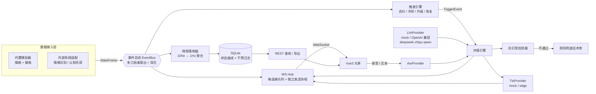
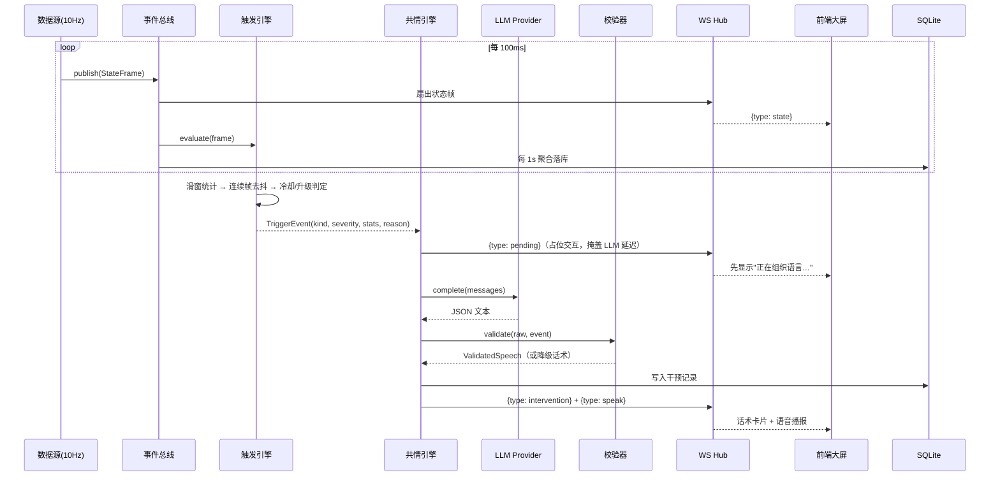

# 基于大模型的智能疏导仓共情语音交互与状态监测系统
## 系统设计与工程实现报告

| 项目 | 内容 |
|---|---|
| 题目 | 题目二 · 基于大模型的智能疏导仓共情语音交互与状态监测系统 |
| 工程方向 | 智能人机交互系统、网络全栈应用开发 |
| 技术栈 | FastAPI + 原生 WebSocket + Vue 3 + ECharts + SQLite（SQLAlchemy 2.0 async） |
| 交付形态 | B/S 架构，端到端可运行 Demo + 自动化测试 + 本报告 |

---

## 一、需求映射

任务书提出四项核心任务与若干工程要求，与实现模块的对应关系如下：

| # | 任务书要求 | 实现位置 | 关键设计 |
|---|---|---|---|
| 1 | 多源状态数据接入与可视化：后端 WebSocket 同步接收"情绪标签"与"脑电认知负荷"两路数据流，前端实时监测大屏 | `app/sources/*`、`app/hub.py`、`app/api/ws_monitor.py`、`frontend/src/views/DashboardView.vue` | 事件总线解耦；每连接队列 + drop-oldest 背压；ECharts 100ms 节流渲染 |
| 2 | 共情策略与 Prompt 工程：接入开源大模型 API，将"情绪+认知"异常状态转化为共情安抚话术 | `app/decision/{trigger,prompt,validator,empathizer}.py`、`app/providers/llm/*` | 去抖状态机控制调用时机；结构化五段式 Prompt；双层抗幻觉 |
| 3 | 语音交互管线：整合 ASR/TTS，形成"数字语音助手"双向闭环 | `app/providers/{asr,tts}/*`、`app/api/ws_voice.py`、`frontend/src/components/VoicePanel.vue` | 文本/二进制混帧协议；TTS 双能力形态（真实音频 / 浏览器合成） |
| 4 | 日志管理与干预记录：记录状态变化曲线与交互干预日志，支持历史查询与导出 | `app/db/*`、`app/api/logs.py`、`frontend/src/views/HistoryView.vue` | 采样 10Hz、落库 1Hz 的聚合降频；双表 + 复合索引；流式 CSV 导出 |
| 工程要求 | 高实时不卡顿 / 抗幻觉 / 结构规范 / 完整 Demo 与报告 | 全项目 | 见第五、六、八章 |

---

## 二、系统架构

### 2.1 分层架构



### 2.2 分层职责与依赖方向

| 层 | 模块 | 职责 | 依赖 |
|---|---|---|---|
| 接入层 | `sources/` | 产出统一 `StateFrame`，屏蔽数据来源差异 | 仅依赖 `bus` 与 `schemas` |
| 传输层 | `bus.py` / `hub.py` | 事件扇出、连接管理、背压推送 | 不依赖任何业务 |
| 决策层 | `decision/` | 异常判定、Prompt 构造、输出校验、话术生成 | 依赖 `providers` 抽象 |
| 适配层 | `providers/` | 屏蔽大模型 / ASR / TTS 厂商差异 | 无内部业务依赖 |
| 存储层 | `db/` | 状态曲线与干预日志的持久化与查询 | 依赖 `schemas` |
| 编排层 | `service/pipeline.py` | 串联完整业务流程 | 依赖以上全部抽象 |
| 接口层 | `api/` | WebSocket 与 REST 端点 | 只读 `app.state` |
| 组装层 | `main.py` | 唯一知道所有具体实现的地方，负责依赖注入 | 依赖全部 |

**依赖方向单向向下**：接入层不认识决策层，决策层不认识数据库。因此"把模拟器换成真实情绪识别系统"
或"把 Mock 换成 DeepSeek / 智谱 GLM / 通义千问"都不需要触碰业务编排代码——这是本系统可扩展性的来源。

### 2.3 一次完整干预的时序



---

## 三、数据契约（单一真源）

全部契约定义在 `backend/app/schemas.py`，被 WebSocket 下行、REST 响应、数据库落库与
前端 `types/contract.ts` 共用，杜绝字段漂移。

```python
class Emotion(BaseModel):     # 音视频情绪标签
    label: Literal["Positive", "Negative", "Neutral"]
    confidence: float         # 0~1

class Cognitive(BaseModel):   # 脑电认知负荷
    level: Literal["Low", "Medium", "High"]
    score: float              # 0~100

class StateFrame(BaseModel):
    ts: float                 # 服务端统一时间戳（秒）
    session_id: str
    emotion: Emotion
    cognitive: Cognitive
    source: str
```

WebSocket 统一信封 `{type, payload}`，前端按 `type` 分发：

| type | 方向 | 含义 |
|---|---|---|
| `meta` | 下行 | 连接元信息（会话号、当前模拟、各适配层状态）；亦用作心跳 pong |
| `state` | 下行 | 状态帧（10Hz） |
| `pending` | 下行 | 干预生成中，占位交互（任务书要求优化 LLM 慢响应体验） |
| `intervention` | 下行 | 干预话术卡片，含决策依据与审计字段 |
| `speak` | 下行 | 播报指令：`audio_b64`（真实 TTS）或纯 `text`（浏览器合成） |
| `asr_final` | 下行（voice 通道） | 语音识别结果 |
| `error` | 下行 | 可读错误提示 |

`Intervention` 中的审计字段（`reason` / `stats` / `prompt_digest` / `degraded` / `provider` /
`latency_ms`）使每一次干预都可事后复核，这是"避免无意义幻觉回复"这一要求在工程上的举证手段。

---

## 四、关键设计决策

### D1 事件总线解耦
数据源只调用 `bus.publish(frame)`，广播、决策、落库各自 `subscribe` 独立消费。
新增消费者（例如后续接入 Webhook 告警）无需改动数据源。

### D2 背压：实时性优先于完整性
`EventBus` 与每条 WS 连接各持一个 `asyncio.Queue(maxsize=64)`，队列满时**丢弃最旧元素**而非阻塞生产者：

```python
def publish(self, item):
    for q in self._subs:
        if q.full():
            q.get_nowait()      # drop-oldest
        q.put_nowait(item)      # 绝不 await
```

广播只做入队（非阻塞），真正的网络 IO 由每连接的独立发送协程完成。
因此**一个慢客户端只会拖慢它自己**——该性质在第八章由实测数据验证。

### D3 渲染节流
数据 10Hz 到达，前端以 100ms 节流批量 `setOption`，ECharts 仅保留最近 300 点滑动窗口
（约 30 秒）。避免高频重绘导致的掉帧。

### D4 触发引擎：先判定，再调模型
逐帧调用大模型会带来三重问题：token 浪费、话术重复、把随机噪声当作真异常从而产生幻觉式结论。
因此异常判定被抽成独立状态机：

| 环节 | 参数（可在 `.env` 调整） | 作用 |
|---|---|---|
| 滑动窗口 | `TRIGGER_WINDOW=15`（≈1.5s） | 统计 Negative 占比与 High 占比 |
| 越线条件 | `TRIGGER_RATIO=0.6` | 任一通道占比超阈即视为候选异常 |
| 去抖 | `TRIGGER_MIN_CONSEC=10` | 连续帧达标才确认，滤除偶发抖动 |
| 冷却 | `TRIGGER_COOLDOWN_S=60` | 同类干预 60s 内不重复打扰 |
| 升级 | `TRIGGER_ESCALATE_AFTER_S=8` | 异常持续恶化时立刻打断冷却、再次干预 |
| 恢复 | `TRIGGER_RECOVERY_FRAMES=20` | 连续常态帧后确认恢复，重置状态机 |

严重度由**强度 × 持续时长**共同决定（而非只看窗口占比）：刚越线 → `mild`（主动陪伴），
持续 8 秒以上且强度 ≥0.85 → `severe`（专业转介）。这与心理疏导"先陪伴、后转介"的逻辑一致，
也避免了一次异常就立即抛出热线号码的体验断裂。

### D5 Prompt 工程
采用五段式结构：**角色 / 硬性约束 / 输入状态 / 输出格式 / few-shot 示例**。

约束项直接对应任务书"避免无意义幻觉回复"的要求：不做医学诊断、不提及药物、
不作疗效承诺、不把临床名词用于描述用户、话术 ≤60 字且可直接朗读；输出被强制为 JSON
（`{"speech", "strategy", "risk"}`），以便机器校验。

用户消息中保留一行机器可读摘要，被模型、Mock Provider 与审计日志共用：

```
[STATE] {"kind": "combined", "severity": "mild", "emotion": "Negative",
         "cognitive_score": 82.0, "negative_ratio": 0.87, "duration_s": 1.2}
```

### D6 抗幻觉：双层防线 + 安全出口

**第一层（时机）**：D4 的去抖状态机确保只在稳定异常时调用模型，从源头减少幻觉输入。

**第二层（内容）**：`validator.py` 对模型输出逐项硬校验。

| 校验项 | 规则 | 不通过时 |
|---|---|---|
| JSON 可解析 | 剥离 ``` 围栏、截取首尾花括号容错 | 重试 1 次（附加更严格指令）→ 兜底 |
| 字段完备 | `speech` 必须为非空字符串 | 兜底 |
| 长度 | 4 ≤ 字数 ≤ 80，超长按标点截断为完整句子 | 截断失败则兜底 |
| 禁词表 | `诊断` / `抑郁症|焦虑症|精神病` / `药` / `包治|一定能好` / `自杀|轻生|自残` 等正则命中即拒 | 兜底 |
| 枚举合法 | `strategy`、`risk` 非法值做保守强制 | 修正 |
| 安全出口 | `severity == severe` 时**不让模型自由发挥**，直接使用确定性转介模板（含心理援助热线 12356） | 覆盖 |

任一环节失败即落到**规则兜底话术库**（按 `kind × severity` 索引的确定性话术），
并在记录中标记 `degraded=true`，前端显示「规则兜底」角标。

由此得到一个强承诺：**无论外部模型是否可用、输出是否合规，系统都不会对用户失语，
也不会输出越界内容**。这也是可被演示与测试验证的（见第八章用例矩阵）。

### D7 外部服务适配层
`LlmProvider` / `AsrProvider` / `TtsProvider` 三个抽象接口 + 工厂函数，
`settings.*_provider` 决定实现。

由于 DeepSeek、智谱 GLM、通义千问、OpenAI 等主流厂商均提供 OpenAI 风格的
`POST {base_url}/chat/completions`，因此大模型侧只写**一个** `OpenAICompatProvider`，
厂商差异收敛为一张 `(默认 base_url, 默认模型)` 表；切换厂商只需改
`LLM_PROVIDER` 与 `LLM_API_KEY`，需要非默认模型或自建网关时再用
`LLM_MODEL` / `LLM_BASE_URL` 覆盖。接口地址由代码显式拼接为完整 URL，
不依赖 HTTP 客户端对 base_url 的路径合并规则，避免不同厂商路径被吞掉。

ASR 侧复用同一思路：`OpenAICompatAsrProvider` 对接 Whisper 兼容的
`POST {base_url}/audio/transcriptions`（默认 `whisper-1`），配置
`ASR_PROVIDER=openai` 与 `ASR_API_KEY` 即从 Mock 切换为云端真实识别，
自建 / 代理网关用 `ASR_BASE_URL`、`ASR_MODEL` 覆盖。未配置 Key 时
`ready=false` 会如实暴露在 `/api/health` 与前端顶栏，不会静默退回 Mock 冒充真实识别。

Mock 实现并非"返回一句固定文案"：

- Mock LLM 解析 Prompt 中的 `[STATE]` 摘要，按异常类型与负荷分值从话术池选槽位，
  语义与真实状态一致；并保留 250ms 固定延迟，用于验证占位交互；
- Mock ASR 返回典型疏导场景语料，用于打通"录音 → ASR → LLM → TTS → 播报"链路；
- Mock TTS 不合成音频，只返回文本，由浏览器 `speechSynthesis` 发声。

`/api/health` 会如实暴露每个适配层的 `name / mode(mock|real) / ready`，前端顶部常驻显示。

### D8 持久化：聚合降频 + 双表
状态帧以 10Hz 采集（满足实时判定），但按 **1Hz 聚合落库**（多数表决决定标签、均值决定分值）。
原因：长时间运行时 10Hz 原始数据会让 SQLite 迅速膨胀，而 1Hz 采样已足以刻画曲线形态。

```sql
state_frames(id, session_id, ts, emotion_label, emotion_confidence,
             cognitive_level, cognitive_score, source)   -- INDEX(session_id, ts)
interventions(id, session_id, ts, kind, severity, reason, prompt_digest, speech,
              strategy, risk, degraded, provider, latency_ms,
              audio_available, stats_json)                -- INDEX(session_id, ts)
```

导出使用 `StreamingResponse`，逐行产出 CSV；含逗号与换行的 `reason` / `speech` 字段按 RFC 4180
用双引号包裹并转义。

### D9 语音闭环
上行音频以 `MediaRecorder` 每 500ms 分片，二进制帧首字节 `0x01` 标记类型（`0x02` 为控制 JSON），
后端累积至 `audio_end` 后触发 ASR。**回复时会把最新 `StateFrame` 摘要一并注入 Prompt**，
实现任务书所述"语音输入状态结合 LLM 生成语音播报"。

为"同一句话不被播两遍"，播报与卡片统一下发到 `/ws/monitor`，`/ws/voice` 只回传 ASR 结果与错误。

---

## 五、数据库与查询

历史页支持按会话与时间范围过滤，返回结构包含 `total / limit / offset / items`，
状态曲线以 `ts` 正序、干预记录以 `ts` 倒序返回。CSV 导出覆盖同样的过滤条件。

会话列表由 `GROUP BY session_id` 聚合出时间范围与采样点数，并与干预计数合并返回。

---

## 六、前端实现要点

- **连接健壮性**：指数退避重连（1s→2s→…→15s 封顶）；15s 心跳 `ping`，连续两次未收到 `pong`
  即主动断开重连，以应对 WS 半开连接（服务端已崩但 TCP 未感知）。
- **状态集中**：`state.ts` 单例保存滑动窗口（300 帧）、干预列表（50 条）、适配层状态等，
  组件只读不复制。用单调递增的 `frameSeq` 触发下游重绘——因为滑动窗口长度会饱和，
  仅监听长度会漏掉后续每一帧。
- **可视化**：情绪圆环（`conic-gradient` 占比环 + 当前标签/置信度）、
  认知负荷曲线（含 70 分高负荷警戒线与负向情绪红点对齐显示）、
  状态色带时间轴（120 格，一眼看出异常持续时长与干预发生位置）、
  干预卡片流（含占位骨架、策略/风险/严重度/时延/降级角标）。
- **播报**：根组件统一消费 `speak` 信号，保证全局只有一路语音输出。

---

## 七、工程规范

- 分层清晰、依赖单向；`main.py` 是唯一组装点。
- 全量类型标注 + Pydantic 数据校验；配置集中在 `config.py`，`.env` 不入库（提供 `.env.example`）。
- 关键设计决策均以注释说明"为什么"，而非仅描述"是什么"。
- 50 个自动化测试用例覆盖决策逻辑、抗幻觉校验、大模型/ASR 适配层、连接层背压、数据源归一化、REST 接口与 WebSocket 集成。

---

## 八、性能与可靠性实测

测试环境：Windows 11 / Python 3.12.2 / 单进程 uvicorn（无反向代理）/ 本机回环。
被测配置：采集 10Hz、落库 1Hz、Mock LLM（固定 250ms 延迟）、4 个并发订阅端。

### 8.1 并发推送与慢消费者隔离（`python -m tests.loadcheck`，采样 20 秒）

| 订阅端 | 收帧数 | 实测帧率 | 最大到达间隔 | P95 间隔 |
|---|---|---|---|---|
| normal-A | 186 | 9.30 Hz | 125.4 ms | 116.3 ms |
| normal-B | 186 | 9.30 Hz | 125.4 ms | 116.4 ms |
| normal-C | 186 | 9.30 Hz | 125.4 ms | 117.2 ms |
| slow（每帧额外 +350ms） | 56 | 2.80 Hz | 373.7 ms | 368.9 ms |
| 服务端统计 | — | 9.23 Hz（测试前 9.26 Hz） | — | — |

结论：

1. 三个正常客户端的实测帧率与采集频率（10Hz）一致，误差 <8%，长时间运行无累积延迟；
2. **故意引入的慢消费者被背压机制自动降级**（2.8Hz，丢的是它自己队列里的旧帧），
   三个正常客户端完全不受影响，服务端整体帧率保持稳定——验证了 D2 的设计目标；
3. 最大到达间隔 125ms（约 1.25 个采样周期）表明推送链路无长阻塞。

### 8.2 干预生成延迟

| 环节 | 实测 |
|---|---|
| 状态异常 → 首次干预（Mock LLM，含约 1s 去抖确认窗口） | 1.23 s |
| 模型生成耗时（Mock 固定延迟 250ms） | 260～277 ms |
| 前端表现 | 立即显示「正在组织语言…」占位卡片，随后替换为正式话术 |

即使接入真实大模型导致生成耗时上升到秒级，占位交互可保证界面不出现"无响应"观感。

### 8.3 功能与正确性测试

`python -m pytest` → **50 passed**。

| 文件 | 用例数 | 覆盖内容 |
|---|---|---|
| `test_trigger.py` | 7 | 连续帧去抖（第 7 帧才触发）、偶发噪声 30 帧不误触发、冷却期抑制、升级打断冷却、恢复重置状态机、单通道（仅负荷）归类、聚合降频 |
| `test_validator.py` | 9 | 代码围栏与噪声容错解析、正常输出通过、非法 JSON 降级、诊断性表述拦截（3 例）、自伤表述拦截、超长按句读截断、高危状态强制安全出口、高危不标低风险、兜底库覆盖完整性 |
| `test_llm_provider.py` | 10 | 厂商表覆盖任务书点名厂商、DeepSeek 请求形态（URL/鉴权头/模型/json_object）、自建网关地址与模型覆盖、HTTP 错误透出厂商原文、无 Key 时 ready=false、**模型抛错时降级为规则话术**、**模型超时时降级**、**重试时提示词仍保留用户原话**、**高危状态短路不调用模型（生成与语音回复两例）** |
| `test_asr_provider.py` | 5 | 工厂按配置选择实现、Whisper 请求形态（URL/鉴权头/multipart/模型名/文件名后缀）、自建网关覆盖、HTTP 错误透出厂商原文、无 Key 时 ready=false |
| `test_sources.py` | 5 | 嵌套报文归一化、中文键别名、**0.0 置信度/分值保真（不被默认值顶替）**、缺字段回落默认值、不可解析报文返回 None |
| `test_api.py` | 8 | 健康检查含四类适配层、四种模拟切换与非法模拟名 422、三类历史查询结构、两份 CSV 表头与 Content-Disposition |
| `test_ws.py` | 3 | 状态帧下行（字段范围校验）、1Hz 落库可见、语音文本上行闭环并落库、空输入被拒绝 |
| `test_hub.py` | 3 | 控制消息不依赖状态帧即刻送达（回归：曾阻塞在空状态队列）、状态帧唤醒空闲发送协程、drop-oldest 丢最旧帧且控制队列免疫 |

其中 `test_llm_provider.py` 与 `test_asr_provider.py` 通过 `httpx.MockTransport` 只替换传输层，
URL 拼接、报文构造等逻辑仍走真实代码，因此在**没有真实 API Key 的环境下也能验证适配层正确性**；
后两个用例则证明即使真实厂商返回 401 或超时，系统仍会给出合规话术而非中断干预。

### 8.4 演示闭环人工验证（浏览器实测）

在 Chromium 中完整走查：顶部「通道已连接」与 `9.x Hz`；认知负荷曲线持续滚动（间隔 5 秒两次
采样时间轴前移且 canvas 校验和变化）；点击「焦虑升级」后出现占位卡片 →
第 1 条为「轻度 · 主动陪伴」→ 约 8 秒后第 2 条升级为「高危 · 安全出口」（含心理援助热线）；
时间轴出现干预位置标记；点击「情绪恢复」出现「状态恢复」卡片；
「历史日志」页会话列表、686 条状态采样点、6 条干预记录均正常渲染；**控制台零报错**。

### 8.5 异常场景降级

| 场景 | 系统行为 |
|---|---|
| 大模型超时 / 抛错 | 记 `degraded=true`，使用规则兜底话术，干预卡片正常展示 |
| 模型输出非法或越界 | 重试 1 次 → 兜底话术，前端显示「规则兜底」角标 |
| 语音合成失败 | 干预流程继续，仅无音频（`audio_available=false`） |
| 慢客户端 | 丢弃其队列中的旧帧，不影响其他客户端 |
| WS 半开连接 | 心跳超时后主动断开并指数退避重连 |
| 落库失败 | 记录错误日志，不中断实时链路 |
| 外部状态系统连接失败 | 指数退避重连（1s→30s 封顶） |
| 麦克风不可用 / 无权限 | 提示改用文字输入，语音面板仍可用 |

---

## 九、部署与运行

```powershell
# 后端
cd backend
python -m pip install -r requirements.txt
python -m uvicorn app.main:app --host 0.0.0.0 --port 8000

# 前端（开发）
cd frontend && npm install && npm run dev     # http://127.0.0.1:5173

# 前端（构建产物由 Nginx / 后端静态托管）
npm run build                                  # 产物在 frontend/dist
```

生产部署建议：由反向代理（Nginx）统一暴露 80/443，将 `/api`、`/ws` 转发到 uvicorn；
WebSocket 需在代理层开启 upgrade 头透传并适当调大 `proxy_read_timeout`；建议以多 worker + 共享
消息中间件替代当前的进程内事件总线（当前设计面向单机演示，跨进程需引入 Redis Pub/Sub 或 MQ）。

---

## 十、已知限制与后续工作

1. **单会话视角**：事件总线与广播面向单一疏导仓实例；多仓并发需为消息增加房间维度并引入外部分发中间件。
2. **进程内状态**：触发引擎与滑动窗口保存在进程内存，多 worker 部署需下沉到 Redis 或粘性会话。
3. **ASR 流式能力**：当前按"分片累积 → 结束时整段转写"，接入云 ASR 的流式接口后可支持边说边出字。
4. **心理策略评估**：现有验证为规则与用例级别；后续可引入心理学量表化的策略匹配评估，
   以及对话历史的情感一致性评估，进一步约束长程对话质量。
5. **鉴权与隐私**：演示版本未实现登录与数据加密；正式场景下脑电与情绪属敏感个人信息，
   需补充身份认证、传输加密与访问审计。

---

## 十一、结论

本系统以**事件驱动 + 适配器模式**组织起一条完整的"感知—决策—交互—记录"闭环，
在满足任务书四项功能要求的同时，重点解决了实时性与内容安全性两个工程难点：

- 实时性通过**每连接队列 + drop-oldest 背压 + 独立发送协程 + 前端渲染节流**保障，
  实测 3 个正常订阅端维持 9.3Hz、慢消费者被自动降级且不影响他人；
- 内容安全通过**触发去抖 + Prompt 硬约束 + 输出硬校验 + 确定性兜底 + 高危安全出口**五重机制保障，
  并以 `degraded` / `prompt_digest` / `stats` 等字段使每次干预可追溯、可测试。

同时，数据源、大模型与语音服务三处外部可变依赖被全部收敛到适配层，
系统在当前无任何云服务凭证的条件下即可完整演示，配置凭证后零代码改动即可切换到真实服务。
